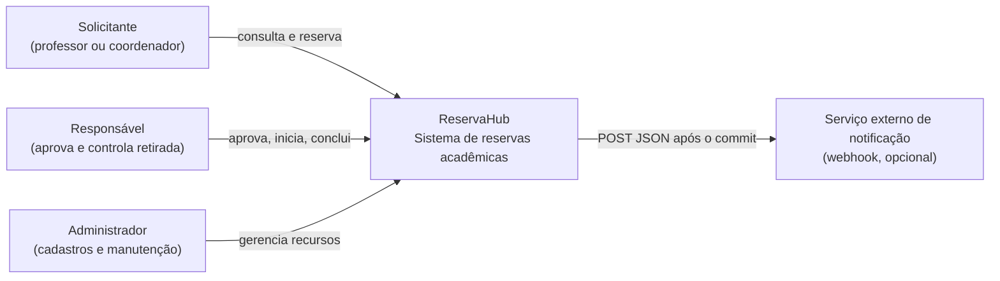
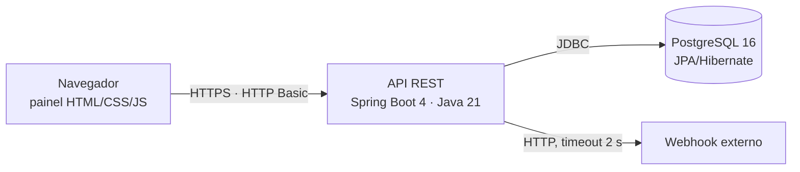
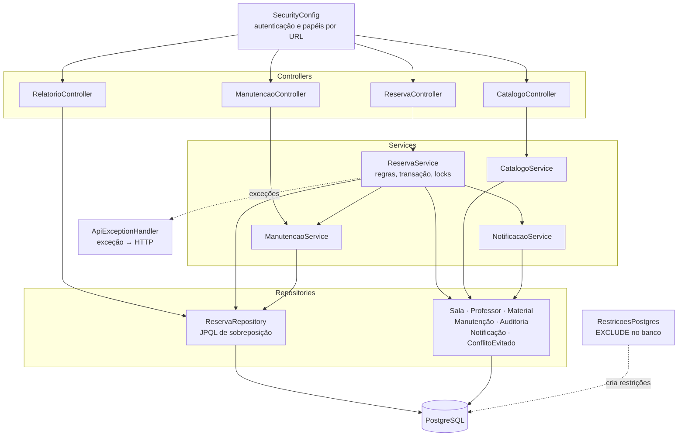
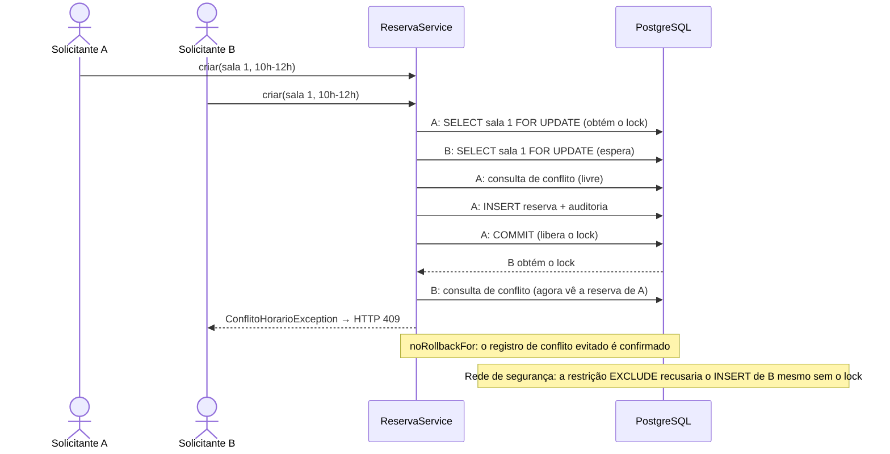
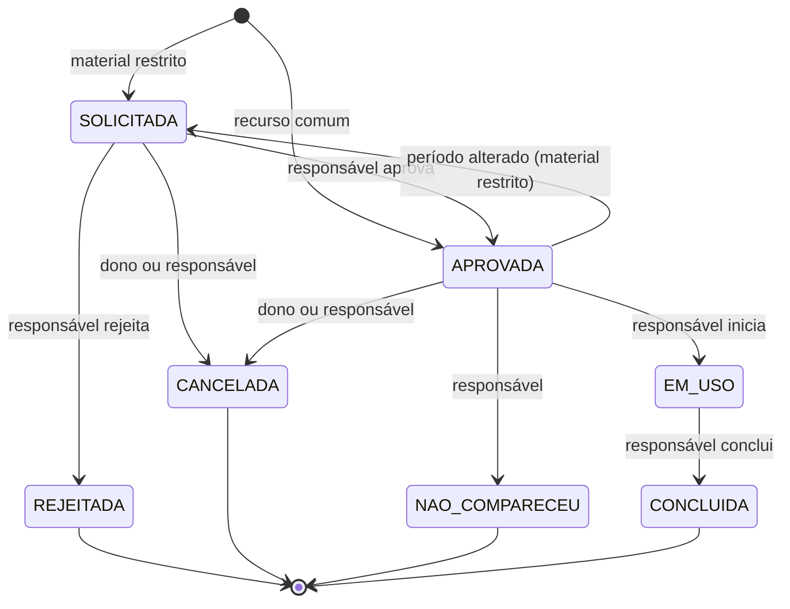

# Arquitetura

Documento no estilo **C4** (contexto → contêineres → componentes) mais as sequências críticas.
Os diagramas são Mermaid e são renderizados pelo GitHub.

## Nível 1 — Contexto

## Nível 2 — Contêineres

## Nível 3 — Componentes da API

**Regra de dependência:** controller → service → repository. O controller não contém regra de negócio.

## Sequência crítica: criar reserva sob concorrência

## Estados da reserva

A volta `APROVADA → SOLICITADA` só ocorre dentro de `alterar` (nova aprovação), nunca pela API de status.

## Decisões de arquitetura

Registradas como ADRs em [`docs/adr/`](adr):

1. [Arquitetura em camadas com Spring Boot](adr/0001-arquitetura-em-camadas.md)
2. [Dupla reserva: lock pessimista + restrição de exclusão](adr/0002-dupla-reserva-lock-e-exclusao.md)
3. [`noRollbackFor` em vez de `REQUIRES_NEW`](adr/0003-norollbackfor-conflito-evitado.md)
4. [Autenticação HTTP Basic para o escopo acadêmico](adr/0004-autenticacao-http-basic.md)
5. [Webhook após o commit, com timeout](adr/0005-webhook-apos-commit.md)

## Atributos de qualidade (utility tree resumida)

| Atributo | Cenário | Tática | Risco / trade-off |
|---|---|---|---|
| Consistência | Duas pessoas reservam o mesmo recurso ao mesmo tempo | Lock pessimista + EXCLUDE | Serializa o mesmo recurso |
| Segurança | Usuário acessa reserva alheia | Autorização por URL e por objeto | CSRF desabilitado com Basic |
| Testabilidade | Validar regras sem banco e a persistência com banco real | Camadas + Testcontainers | Testes de integração exigem Docker |
| Desempenho | Muitos usuários simultâneos | Locks por recurso, índices | **BCrypt a cada requisição limita a vazão** |
| Resiliência | Serviço de notificação lento ou fora | Timeout, após o commit, falha isolada | Notificação pode ser perdida (sem fila) |
